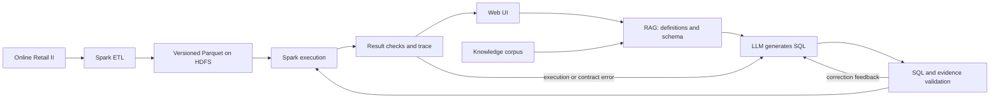

# Customer Intelligence Agent with Spark & HDFS

ระบบวิเคราะห์ข้อมูลลูกค้าและยอดขายด้วยภาษาธรรมชาติ ผู้ใช้ถามผ่านเว็บ แล้ว Agent ค้นนิยามธุรกิจด้วย RAG สร้าง SQL และประมวลผลบน Apache Spark โดยอ่านข้อมูลจาก HDFS

ผลลัพธ์แสดงเป็นตาราง พร้อม SQL และหลักฐานที่ใช้ เพื่อให้ผู้ใช้ตรวจสอบวิธีคำนวณและที่มาของคำตอบได้

[Presentation](presentation/customer-intelligence-v2.4-release.pptx) · [Architecture](reports/ARCHITECTURE.md) · [ผลประเมิน](reports/DELIVERY_REPORT.md) · [วิธีใช้งานเว็บ](docs/WEB_APP.md)

## ใช้ทำอะไรได้บ้าง

| งานวิเคราะห์ | ตัวอย่าง |
|---|---|
| ยอดขายและคำสั่งซื้อ | ยอดขาย จำนวน invoice และมูลค่าเฉลี่ยต่อคำสั่งซื้อในช่วงเวลาที่กำหนด |
| พฤติกรรมการซื้อ | จำนวนลูกค้าที่ซื้อและสัดส่วนลูกค้าที่ซื้อซ้ำ |
| การจัดอันดับ | ลูกค้า ประเทศ หรือสินค้าตามยอดขาย จำนวนคำสั่งซื้อ หรือจำนวนสินค้าที่ขาย |
| กลุ่มลูกค้า | วิเคราะห์ RFM segments และ high-value customers ณ snapshot ที่มีข้อมูล |

ระบบช่วยให้ผู้ใช้สำรวจข้อมูลโดยไม่ต้องเริ่มจากการเขียน SQL เอง หากคำถามขาดช่วงเวลาหรือขอข้อมูลที่ไม่มี ระบบจะถามกลับหรือแจ้งข้อจำกัด

## Architecture



- **Data platform:** Hadoop 3.4.1 พร้อม NameNode 1 ตัวและ DataNodes 2 ตัว ตั้ง replication เป็น 2; Spark 4.1.3 พร้อม master 1 ตัวและ workers 2 ตัว
- **RAG:** BM25 ร่วมกับคำศัพท์ไทย/อังกฤษ ดึงนิยาม metric, schema, syntax และ policy ที่เกี่ยวข้อง พร้อม IDs อ้างอิง
- **Agent:** Qwen3.5 9B ผ่าน Ollama สร้าง SQL เอง ตรวจคำสั่งและความสอดคล้องกับหลักฐานก่อนรัน แก้ตาม feedback ได้รวมไม่เกิน 3 รอบ
- **Application:** เว็บสำหรับป้อนคำถาม ดูตารางผลลัพธ์ และเปิดรายละเอียด SQL หลักฐานและ trace

ระบบทำงานผ่าน Docker บนเครื่องเดียว โดย Ollama ใช้ GPU ของเครื่อง host

## Workflow ของ Agent

1. ค้นหลักฐานและตรวจว่าคำถามมีเงื่อนไขเพียงพอ
2. สร้าง SQL พร้อมคำอธิบายและ citations
3. ตรวจ SQL แบบ AST, เงื่อนไขประชากรลูกค้า และ evidence consistency
4. รันบน Spark แล้วตรวจผลบางเงื่อนไข เช่น customer ID ว่างหรือค่าของ fraction
5. คืนผลให้ผู้ใช้ หรือส่งข้อผิดพลาดกลับให้โมเดลแก้ภายในจำนวนรอบที่กำหนด

Context engineering ครอบคลุมการเลือกหลักฐาน การจำกัดขนาด input แบบประมาณ และการเก็บเฉพาะสถานะแก้ไขล่าสุด พร้อมบันทึกจำนวน token ที่ Ollama ใช้จริง

## ข้อมูลที่ใช้

ใช้ [Online Retail II จาก UCI](https://archive.ics.uci.edu/dataset/502/online+retail+ii) จำนวน **1,067,371 แถว** ในช่วงปี 2009–2011 ข้อมูลต้นฉบับมีทั้งรายการขาย การยกเลิก การคืนสินค้า และรายการที่ไม่มี customer ID

| ตาราง | ระดับข้อมูล |
|---|---|
| `sales_lines` | หนึ่งรายการสินค้าในข้อมูลต้นฉบับ |
| `orders` | หนึ่ง invoice ของรายการขายที่ผ่านกฎการเตรียมข้อมูล |
| `customer_summary` | หนึ่งลูกค้าที่ระบุตัวตนได้ ในหน้าต่าง 180 วัน ณ snapshot |

Pipeline เก็บ source hashes, จำนวนแถว และผล reconciliation พร้อมเขียนตารางเป็น version ใหม่บน HDFS เพื่อย้อนตรวจที่มาของข้อมูลได้ นิยาม metric และกฎการจัดกลุ่มอยู่ใน [knowledge/](knowledge/)

ข้อมูล: Chen, D. (2012), Online Retail II, UCI Machine Learning Repository, [DOI: 10.24432/C5CG6D](https://doi.org/10.24432/C5CG6D), CC BY 4.0

## ผลประเมิน

ผลของ **v2.4** จากชุดคำถามใหม่ 20 ข้อที่จัดทำก่อน freeze โค้ด โมเดล และ knowledge ที่ใช้ประเมิน:

| มิติ | ผล |
|---|---:|
| คำตอบตรงผล Spark / การถามกลับถูกต้อง | 20/20 |
| Retrieval Recall@6 | 100% |
| MRR@6 | 0.892 |
| nDCG@6 | 0.893 |
| Citation ID validity | 100% |
| Retrieval latency p95 | 16.69 ms |
| Warm-query latency p95 | 5.43 s |

ชุดประเมินประกอบด้วย SQL 17 ข้อและ clarification 3 ข้อ เป็นชุดขนาดเล็กที่ผู้พัฒนาสร้างจากกลุ่มงานที่รองรับ จึงยังไม่สะท้อนความถูกต้องกับคำถามทุกประเภท เวลา warm-query ไม่รวมการเริ่ม Spark application และ citation ID ที่ถูกต้องไม่ได้รับประกันความหมายของคำตอบ

Unit tests ผ่าน 25 ข้อบนเครื่องพัฒนาและจาก local Git checkout; [GitHub Actions](https://github.com/NATTAPAT-LEUNGRUNGSAP/customer-intelligence-agent-spark-hdfs/actions) รัน unit-test workflow ผ่านแล้ว การทดสอบ Spark, HDFS และ Ollama ทำแยกบนเครื่องพัฒนา

ดูวิธีวัด ผลรายข้อ และข้อผิดพลาดจากรอบก่อนใน [รายงานผล](reports/DELIVERY_REPORT.md) และ [Evaluation protocol](evaluation/README.md)

## เริ่มใช้งาน

ต้องมี Docker Desktop ที่ใช้ Linux containers และ Ollama เครื่องที่ใช้ประเมินมี RAM ประมาณ 32 GB และ RTX 5070 12 GB; ความต้องการทรัพยากรขึ้นกับโมเดลและการจัดสรรให้ Docker

### 1. เตรียมโมเดลและเริ่มคลัสเตอร์

```powershell
ollama pull qwen3.5:9b
powershell -ExecutionPolicy Bypass -File ./scripts/start.ps1
```

Container ต้องเข้าถึง Ollama ผ่าน `host.docker.internal:11434` ได้ สคริปต์เริ่มคลัสเตอร์จะตรวจ readiness และรัน Spark/HDFS smoke test

### 2. เตรียมข้อมูล

```powershell
powershell -ExecutionPolicy Bypass -File ./scripts/build-data.ps1
```

สำหรับการติดตั้งใหม่ ให้ใช้ไฟล์ `reports/build-*.json` ที่ได้จากรอบของเครื่องนั้นและมี `status=passed` แล้วแก้ค่า `--manifest` ใน [compose.web.yaml](compose.web.yaml) ให้ตรงกับ path ภายใน container เช่น `/app/reports/build-<run-id>.json`

### 3. เปิดเว็บ

```powershell
powershell -ExecutionPolicy Bypass -File ./scripts/start-web.ps1
```

เปิด **http://localhost:8090** หลัง Spark เริ่มพร้อม ตัวอย่างคำถาม:

- เดือนตุลาคม 2011 มีคำสั่งซื้อสำเร็จกี่ใบ
- Top three identified customers by total completed sales in January 2011; ties by customer ID ascending.
- RFM distribution at snapshot 2011-12-01.

คำถามแต่ละข้อประมวลผลแยกกัน รายละเอียดการตั้งค่า การเรียกผ่าน CLI และการหยุดระบบอยู่ใน [Web application guide](docs/WEB_APP.md) และ [scripts/](scripts/)

## การทดสอบ

```powershell
docker compose run --rm --no-deps --entrypoint python3 spark-job -m unittest discover -s /app/tests -v
```

หยุด web service ก่อนรัน batch Spark evaluation เพื่อคืนทรัพยากรให้ workers แล้วทำตาม [Evaluation protocol](evaluation/README.md) โดยใช้ build manifest ของเครื่องที่ทดสอบ

## ข้อจำกัด

- เป็น local application บนเครื่องเดียว ยังไม่มี authentication สำหรับให้บริการสาธารณะ
- ข้อมูลเป็นประวัติศาสตร์และมี snapshot ที่เตรียมไว้เท่านั้น
- การตรวจ SQL และผลลัพธ์ครอบคลุมบางเงื่อนไข ผู้ใช้ยังควรตรวจวิธีคำนวณก่อนนำผลไปใช้
- จำกัดผลลัพธ์ 200 แถว และส่งคำสั่งยกเลิก Spark job เมื่อเกิน 45 วินาที การยกเลิกเป็น best effort
- Context budget เป็น heuristic; การทดสอบเบื้องต้นยังไม่พิสูจน์ว่าป้องกัน context rot ได้ทั่วไป
- ยังไม่ได้ยืนยันการดาวน์โหลดและ build ข้อมูลใหม่ครบกระบวนการบนเครื่องอื่น
