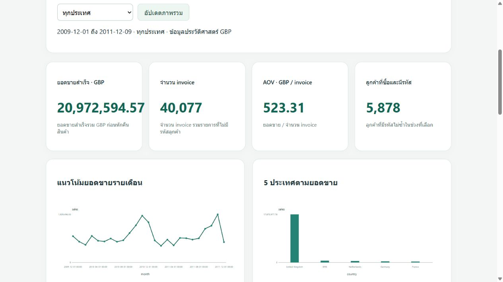

# Customer Intelligence Agent

เว็บวิเคราะห์ยอดขายและลูกค้าจากชุดข้อมูล Online Retail II ปี 2009–2011 พิมพ์คำถามภาษาไทยหรืออังกฤษ แล้วดูตาราง คำสั่ง SQL และหลักฐานที่ใช้คำนวณได้ในหน้าเดียว

[คู่มือเปิดเว็บ](docs/WEB_APP.md) · [สไลด์นำเสนอ](presentation/customer-intelligence-talk.pptx) · [ผลประเมิน](reports/BENCHMARK_FOLLOWUP.md) · [คู่มืออ่านโค้ด](docs/CODE_HANDOFF.md)

## ใช้ทำอะไรได้บ้าง

| งาน | ตัวอย่าง |
|---|---|
| ดูภาพรวมยอดขาย | ใช้ Dashboard ดูยอดขาย จำนวนใบสั่งซื้อ มูลค่าเฉลี่ยต่อใบ และจำนวนผู้ซื้อที่มีรหัส ตามช่วงเวลาและประเทศ |
| ถามเจาะลึก | “เดือนตุลาคม 2011 มีใบสั่งซื้อสำเร็จกี่ใบ” ผลที่ยืนยันจากการรันจริงคือ **2,040 ใบ** |
| เปรียบเทียบสินค้า | “มีสินค้าอะไรบ้าง และยอดขายแต่ละอย่างเท่าไรและจำนวนเท่าไร” คืนรหัส ชื่อ ยอดขาย และจำนวนชิ้น |
| สำรวจข้อมูลและสูตร | “มีคอลัมน์อะไรบ้างในฐานข้อมูล” หรือ “ขอสูตร AOV” เพื่อดูโครงสร้างและนิยามก่อนวิเคราะห์ |

## เริ่มใช้งาน

1. เปิด Docker Desktop และ Ollama แล้วรัน `ollama pull qwen3.5:9b`
2. รัน `.\scripts\start.ps1` จากโฟลเดอร์โปรเจกต์
3. ติดตั้งครั้งแรกให้รัน `.\scripts\build-data.ps1` แล้วตั้ง `--manifest` ใน [compose.web.yaml](compose.web.yaml) ให้ตรงกับไฟล์ผลเตรียมข้อมูลที่ผ่านของเครื่องนั้น
4. รัน `.\scripts\start-web.ps1` แล้วเปิด [เว็บวิเคราะห์](http://localhost:8090/) เมื่อระบบพร้อม

ตรวจว่าเว็บพร้อมที่ [`/api/status`](http://localhost:8090/api/status) เว็บใช้ข้อมูลทั้งหมดเป็นค่าเริ่มต้น หากระบุช่วงเวลาในคำถาม ระบบใช้ช่วงนั้นก่อนตัวเลือกในหน้าเว็บ

## ระบบทำงานอย่างไร

Spark เตรียมข้อมูลเป็นไฟล์ Parquet บน HDFS มีสามตาราง ได้แก่ `sales_lines` สำหรับรายการสินค้า `orders` สำหรับใบสั่งซื้อสำเร็จ และ `customer_summary` สำหรับข้อมูลสรุปลูกค้า ณ วันที่กำหนด

| ส่วนประกอบ | หน้าที่ |
|---|---|
| RAG และ Ontology | BM25 ค้นนิยาม สูตร และโครงสร้างตารางจากคลังความรู้ไทย–อังกฤษ กราฟ Ontology เชื่อมคำธุรกิจกับตาราง และใช้ SHACL ตรวจโครงสร้างกราฟ |
| Qwen และ Agent Loop | โมเดลเขียน SQL จากคำถามและหลักฐาน เมื่อพบข้อผิดพลาดที่แก้ได้ Agent ส่ง SQL กับเหตุผลล่าสุดกลับให้แก้ ภายในงบรวมสามรอบ |
| จุดตรวจก่อนและหลัง Spark | ก่อนรันตรวจคำสั่งแบบอ่านอย่างเดียว ความหมาย และนโยบาย OPA หลังรันตรวจรูปแบบผลและนโยบายก่อนคืนตาราง |
| Spark และ HDFS | Spark คำนวณจาก Parquet บน HDFS หน้าเว็บแสดงตาราง SQL หลักฐาน และรหัส trace สำหรับย้อนดูการรัน |

Dashboard ใช้ SQL ที่เตรียมไว้สำหรับตัวเลขภาพรวม ส่วนช่องถาม AI ใช้ SQL ที่ Agent สร้างทีละคำถาม คำถามดูคอลัมน์อ่านจาก schema ที่โหลดไว้โดยตรง

[สถาปัตยกรรม](reports/ARCHITECTURE.md) · [นิยามธุรกิจและกฎตรวจ](docs/GOVERNANCE.md) · [การจัดบริบท](docs/CONTEXT_ENGINEERING.md) · [จุดตรวจก่อนและหลัง Spark](docs/TOOL_HOOKS.md)

## ผลประเมิน

**SQL Correctness** เทียบตารางจาก Agent กับผล SQL อ้างอิงที่รันแยกบนข้อมูลเดียวกัน ส่วน **Faithfulness** ตรวจว่าคำอธิบายมีหลักฐานรองรับหรือไม่

| ชุดที่รันจริง | ผล |
|---|---|
| ชุดพัฒนา 200 ข้อ ก่อนแก้กฎ SQL | ผล SQL ตรงคำตอบอ้างอิง **144/160** · ขอสูตร **24/24** · ถามกลับตามเกณฑ์ **16/16** |
| โจทย์เดิมที่รันก่อนและหลังแก้ | **11/16 → 16/16** |
| โจทย์ใหม่หลังแก้ | **11/12** |
| ชุดทดลอง SQL 40 ข้อใน Langfuse | ผล SQL ตรง **36/40** · คำอธิบายผ่านเกณฑ์ **32/40** |

เกณฑ์คำอธิบายนับข้อที่ไม่มีข้อความให้ตรวจเป็นไม่ผ่าน ตัวตรวจยังจับข้ออ้างผิดได้เพียง **2/8** ในชุดควบคุม ผลนี้จึงใช้ดูข้อจำกัดของตัวตรวจ [เปิดหน้าสรุปสองคะแนน](reports/evaluation-quadrants.html) · [วิธีดูผลใน Langfuse](docs/LANGFUSE_EVALUATION.md)

## ขอบเขตและการใช้งานเพิ่มเติม

- ข้อมูลไม่มีต้นทุน กำไร หรือหมวดหมู่สินค้าที่ตรวจสอบแล้ว เว็บรับคำถามทีละงานและส่งผลได้ไม่เกิน 200 แถว
- [แชร์เว็บให้เพื่อนทดลอง](docs/FRIEND_ACCESS.md) · [เรียก Agent ผ่าน MCP](docs/agentic-improvements.md) · [วิธีรันชุดประเมิน](evaluation/README.md)
- แหล่งข้อมูล [Online Retail II, UCI](https://archive.ics.uci.edu/dataset/502/online+retail+ii) (CC BY 4.0)
