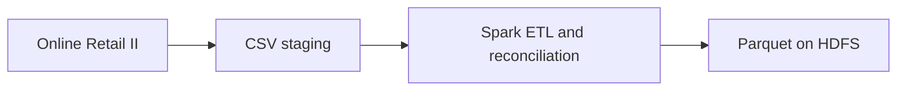
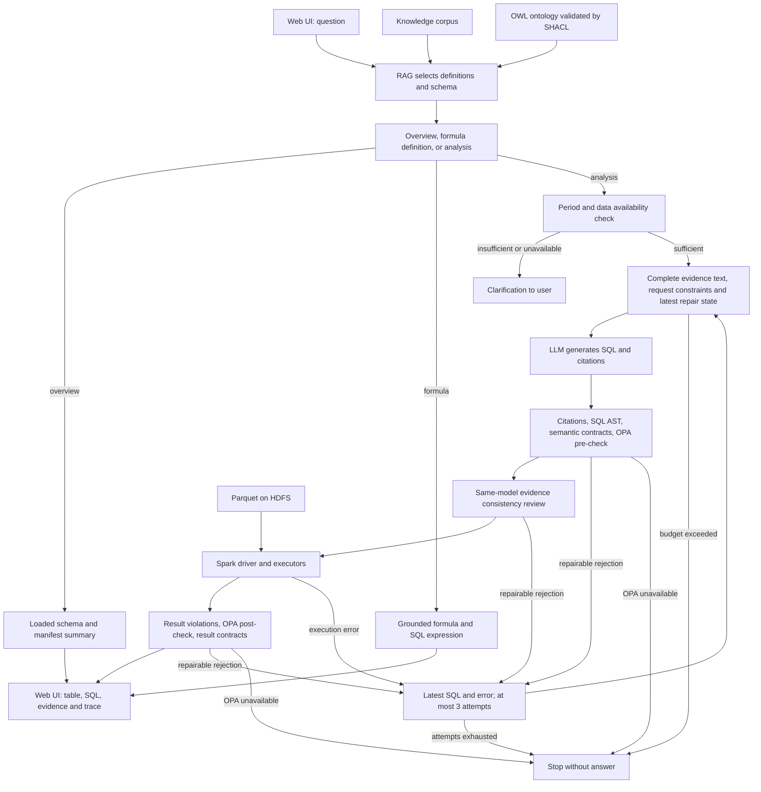

# Customer Intelligence Agent with Spark & HDFS

ระบบวิเคราะห์ข้อมูลลูกค้าและยอดขายด้วยภาษาธรรมชาติ ผู้ใช้ถามผ่านเว็บ แล้ว Agent ค้นนิยามธุรกิจด้วย RAG สร้าง SQL และประมวลผลบน Apache Spark โดยอ่านข้อมูลจาก HDFS

ผลลัพธ์แสดงเป็นตาราง พร้อม SQL และหลักฐานที่ใช้ เพื่อให้ผู้ใช้ตรวจสอบวิธีคำนวณและที่มาของคำตอบได้

[Presentation](presentation/customer-intelligence-system-guide.pptx) · [Architecture](reports/ARCHITECTURE.md) · [ผลประเมิน](reports/BILINGUAL_ANALYTICS_REPORT.md) · [วิธีใช้งานเว็บ](docs/WEB_APP.md)

## ใช้ทำอะไรได้บ้าง

| งานวิเคราะห์ | ตัวอย่าง |
|---|---|
| ยอดขายและคำสั่งซื้อ | ยอดขาย จำนวน invoice และมูลค่าเฉลี่ยต่อคำสั่งซื้อในช่วงเวลาที่กำหนด |
| พฤติกรรมการซื้อ | จำนวนลูกค้าที่ซื้อและสัดส่วนลูกค้าที่ซื้อซ้ำ |
| การจัดอันดับ | ลูกค้า ประเทศ หรือสินค้าตามยอดขาย จำนวนคำสั่งซื้อ หรือจำนวนสินค้าที่ขาย |
| กลุ่มลูกค้า | วิเคราะห์ RFM segments และ high-value customers ณ snapshot ที่มีข้อมูล |

ระบบช่วยให้ผู้ใช้สำรวจข้อมูลโดยไม่ต้องเริ่มจากการเขียน SQL เอง หากคำถามขาดช่วงเวลาหรือขอข้อมูลที่ไม่มี ระบบจะถามกลับหรือแจ้งข้อจำกัด

มี [ชุดคำถามไทย 100 ข้อและอังกฤษ 100 ข้อ](docs/QUESTION_BANK.md) สำหรับพัฒนาระบบ
พร้อม [นิยามสูตรและรูปแบบ SQL สำหรับ RAG](docs/ANALYTICS_RAG.md) เช่น AOV,
สัดส่วนลูกค้าซื้อซ้ำ สถิติ และ window functions. ขอสูตรได้โดยไม่รันคำนวณ เช่น
`ขอสูตรAOV ไม่ต้องรัน SQL`; การถามตัวเลขยังผ่านการสร้างและตรวจ SQL ตามปกติ.

## Architecture

### เส้นทางเตรียมข้อมูล



### เส้นทางตอบคำถาม



RAG ค้นก่อนเริ่มวงรอบแก้ SQL ส่วนรอบแก้เก็บเอกสารเดิมและสถานะล่าสุด การเตรียมข้อมูลเป็นอีกงานหนึ่ง ไม่ได้ทำ ETL ใหม่ทุกคำถาม SHACL ตรวจกราฟนิยาม ส่วน SQL guards, OPA และ result checks ตรวจการเรียกเครื่องมือและผลลัพธ์คนละหน้าที่


- **Data platform:** Hadoop 3.4.1 พร้อม NameNode 1 ตัวและ DataNodes 2 ตัว ตั้ง replication เป็น 2; Spark 4.1.3 พร้อม master 1 ตัวและ workers 2 ตัว
- **RAG:** BM25 ร่วมกับคำศัพท์ไทย/อังกฤษ ดึงนิยาม metric, schema, syntax และ policy ที่เกี่ยวข้อง พร้อม IDs อ้างอิง
- **Agent:** Qwen3.5 9B ผ่าน Ollama สร้าง SQL เอง ตรวจคำสั่งและความสอดคล้องกับหลักฐานก่อนรัน แก้ตาม feedback ได้รวมไม่เกิน 3 รอบ
- **Application:** เว็บสำหรับป้อนคำถาม ดูตารางผลลัพธ์ และเปิดรายละเอียด SQL หลักฐานและ trace

ระบบทำงานผ่าน Docker บนเครื่องเดียว โดย Ollama ใช้ GPU ของเครื่อง host

## Workflow ของ Agent

1. ค้นหลักฐานและตรวจว่าคำถามมีเงื่อนไขเพียงพอ
2. สร้าง SQL พร้อมคำอธิบายและ citations
3. ตรวจ SQL แบบ AST, เงื่อนไขประชากรลูกค้า และ evidence consistency
4. ให้ OPA อนุญาตก่อนรัน Spark แล้วตรวจโครงสร้างผล ตัวเลข ID และสัดส่วน พร้อมให้ OPA ตัดสินก่อนคืนคำตอบ
5. คืนผลให้ผู้ใช้ หรือส่งข้อผิดพลาดกลับให้โมเดลแก้ภายในจำนวนรอบที่กำหนด

Context engineering เก็บหลักฐานที่เลือกไว้ครบ ตรวจ ID ซ้ำที่เนื้อหาขัดกัน และเก็บเฉพาะ SQL กับข้อผิดพลาดล่าสุดเมื่อแก้คำตอบ พร้อมจำกัด input แบบประมาณและบันทึก token ที่ Ollama ใช้จริง ดู [การออกแบบและข้อจำกัด](docs/CONTEXT_ENGINEERING.md)

## ข้อมูลที่ใช้

ใช้ [Online Retail II จาก UCI](https://archive.ics.uci.edu/dataset/502/online+retail+ii) จำนวน **1,067,371 แถว** ในช่วงปี 2009–2011 ข้อมูลต้นฉบับมีทั้งรายการขาย การยกเลิก การคืนสินค้า และรายการที่ไม่มี customer ID

| ตาราง | ระดับข้อมูล |
|---|---|
| `sales_lines` | หนึ่งรายการสินค้าในข้อมูลต้นฉบับ |
| `orders` | หนึ่ง invoice ของรายการขายที่ผ่านกฎการเตรียมข้อมูล |
| `customer_summary` | หนึ่งลูกค้าที่ระบุตัวตนได้ ในหน้าต่าง 180 วัน ณ snapshot |

Pipeline เก็บ source hashes, จำนวนแถว และผล reconciliation พร้อมเขียนตารางเป็น version ใหม่บน HDFS เพื่อย้อนตรวจที่มาของข้อมูลได้ นิยาม metric และกฎการจัดกลุ่มอยู่ใน [knowledge/](knowledge/)

ข้อมูล: Chen, D. (2012), Online Retail II, UCI Machine Learning Repository, [DOI: 10.24432/C5CG6D](https://doi.org/10.24432/C5CG6D), CC BY 4.0

## ผลประเมิน

หลังผลชุดนี้ มีการแก้คำถามหมวดหมู่สินค้าให้แจ้งว่าข้อมูลไม่มี taxonomy แทนการถามช่วงเวลา: unit tests 95 ข้อและ HTTPS 3 กรณีผ่าน แต่ยังไม่ได้รันชุด 200 ข้อใหม่บนการแก้นี้.

รันชุดพัฒนาไทย 100 ข้อและอังกฤษ 100 ข้อจริง ได้ **196/200**
(ไทย 97/100; อังกฤษ 99/100).
เป็นคำถามสองภาษาของ 100 เจตนา และถูกใช้ปรับระบบแล้ว จึงไม่ใช่ independent holdout.

| สิ่งที่วัด | ผลจริง |
|---|---:|
| โจทย์ SQL เทียบผลกับ SQL อ้างอิงที่รันบนข้อมูลจริง | 156/160 |
| เลือกสูตรที่มีหลักฐาน โดยไม่รันคำนวณ | 24/24 |
| ถามกลับ/แจ้งข้อมูลไม่รองรับ | 16/16 |
| สูตร 12 สูตรกับตัวเลขควบคุมและ edge cases บน Spark | 16/16 |
| Retrieval Recall@6 บนคำถามต้นฉบับชุดเดียวกัน ก่อน → หลัง | 64.5% → 98.50% |
| เวลาตอบ p95 ในรอบ 200 คำถาม | 6.27 วินาที |
| Unit tests / OPA integration | 93 ผ่าน / 3 ผ่าน |

ยังมี **4 ข้อไม่ผ่าน**; รายงานแยกกรณีหยุดตรวจออกจากผลที่รันแล้วไม่ตรงอ้างอิง
รวมทั้งกรณีคอลัมน์หรือช่วงเวลาไม่ตรง ไม่ได้อ้างว่ารองรับทุกคำถามแล้ว.
RAG ก่อนปรับยังไม่มีสูตร/syntax ใหม่บางหัวข้อ ผลก่อน–หลังจึงรวมการเพิ่ม knowledge coverage.

Context ส่ง ID และข้อความหลักฐานเต็ม โดยเก็บ metadata ไว้ใน trace แทน.
ตรวจ packet ของ 160 โจทย์ SQL พบว่าขนาด evidence ลด **21.06%**
เมื่อเทียบกับ references ชุดเดียวกันที่แนบ metadata และ hash ของ ID/ข้อความตรงครบ.
นี่เป็นการวัด bytes ของ evidence ไม่ใช่หลักฐานว่าแก้ context rot ทั่วไปแล้ว.

ดู [วิธีวัด ผลดิบ และรายการที่ไม่ผ่าน](reports/BILINGUAL_ANALYTICS_REPORT.md).
ผลชุดก่อนขยาย 60/60 และ regression 80/80 เก็บเป็น
[ผลประเมินก่อนหน้า](reports/GOVERNANCE_REPORT.md) และไม่ถูกนำมาปะปนกับชุดนี้.

มี domain ontology แบบ RDF/OWL พร้อม SHACL และ OPA/Rego ก่อนและหลัง Spark.
สูตรเชิงประกอบและ metric ใหม่เก็บเป็นนิยาม RAG; ไม่ได้อ้างว่าทั้งหมดถูกเพิ่มเป็น OWL metrics.
อ่าน [การออกแบบและคำอธิบายศัพท์](docs/GOVERNANCE.md).

## เริ่มใช้งาน

ต้องมี Docker Desktop ที่ใช้ Linux containers และ Ollama เครื่องที่ใช้ประเมินมี RAM ประมาณ 32 GB และ RTX 5070 12 GB; ความต้องการทรัพยากรขึ้นกับโมเดลและการจัดสรรให้ Docker

### 1. เตรียมโมเดลและเริ่มคลัสเตอร์

```powershell
ollama pull qwen3.5:9b
powershell -ExecutionPolicy Bypass -File ./scripts/start.ps1
```

Container ต้องเข้าถึง Ollama ผ่าน `host.docker.internal:11434` ได้ สคริปต์เริ่มคลัสเตอร์จะตรวจ readiness และรัน Spark/HDFS smoke test

### 2. เตรียมข้อมูล

```powershell
powershell -ExecutionPolicy Bypass -File ./scripts/build-data.ps1
```

สำหรับการติดตั้งใหม่ ให้ใช้ไฟล์ `reports/build-*.json` ที่ได้จากรอบของเครื่องนั้นและมี `status=passed` แล้วแก้ค่า `--manifest` ใน [compose.web.yaml](compose.web.yaml) ให้ตรงกับ path ภายใน container เช่น `/app/reports/build-<run-id>.json`

### 3. เปิดเว็บ

```powershell
powershell -ExecutionPolicy Bypass -File ./scripts/start-web.ps1
```

เปิด **http://localhost:8090** หลัง Spark เริ่มพร้อม ตัวอย่างคำถาม:

- เดือนตุลาคม 2011 มีคำสั่งซื้อสำเร็จกี่ใบ
- Top three identified customers by total completed sales in January 2011; ties by customer ID ascending.
- RFM distribution at snapshot 2011-12-01.

คำถามแต่ละข้อประมวลผลแยกกัน รายละเอียดการตั้งค่า การเรียกผ่าน CLI และการหยุดระบบอยู่ใน [Web application guide](docs/WEB_APP.md) และ [scripts/](scripts/)

## ให้เพื่อนทดลองผ่าน HTTPS

มีโหมดแชร์ชั่วคราวผ่าน Cloudflare Tunnel และ Caddy ที่บังคับชื่อผู้ใช้/รหัสผ่านแล้ว เพื่อนเปิดลิงก์ในเบราว์เซอร์ได้โดยไม่ต้องติดตั้งระบบเอง อ่าน [วิธีเปิด ปิด และเปลี่ยนรหัส](docs/FRIEND_ACCESS.md)

```powershell
python scripts/friend_access.py start
python scripts/friend_access.py stop
```

ลิงก์และรหัสอยู่ใน `.private/friend-access.txt` ซึ่งไม่ถูกส่งขึ้น GitHub ต้องเปิดเครื่อง Docker โมเดล และแอปไว้ ระบบยังรับคำถามทีละงาน นี่เป็นการแชร์เพื่อทดลอง ไม่ใช่บริการ production ที่มีบัญชีแยกรายผู้ใช้

ทดสอบผ่าน HTTPS จริง 13 เงื่อนไข รวมการบล็อกรหัสผิด ตรวจ Origin และผล Spark 2,040 invoices ดู [รายงานที่ไม่ใส่ข้อมูลลับ](reports/friend-access-verification.json) ผลนี้เป็นการตรวจ gateway แยกจาก benchmark analytics เดิม

## การทดสอบ

```powershell
docker compose run --rm --no-deps --entrypoint python3 spark-job -m unittest discover -s /app/tests -v
```

หยุด web service ก่อนรัน batch Spark evaluation เพื่อคืนทรัพยากรให้ workers แล้วทำตาม [Evaluation protocol](evaluation/README.md) โดยใช้ build manifest ของเครื่องที่ทดสอบ

## ข้อจำกัด

- เป็น local application บนเครื่องเดียว โหมดแชร์มี password gateway แต่ยังไม่มีบัญชีหรือสิทธิ์แยกรายผู้ใช้สำหรับ production
- ข้อมูลเป็นประวัติศาสตร์และมี snapshot ที่เตรียมไว้เท่านั้น
- การตรวจ SQL และผลลัพธ์ครอบคลุมบางเงื่อนไข ผู้ใช้ยังควรตรวจวิธีคำนวณก่อนนำผลไปใช้
- จำกัดผลลัพธ์ 200 แถว และส่งคำสั่งยกเลิก Spark job เมื่อเกิน 45 วินาที การยกเลิกเป็น best effort
- Context budget เป็น heuristic; การทดสอบเบื้องต้นยังไม่พิสูจน์ว่าป้องกัน context rot ได้ทั่วไป
- ยังไม่ได้ยืนยันการดาวน์โหลดและ build ข้อมูลใหม่ครบกระบวนการบนเครื่องอื่น
