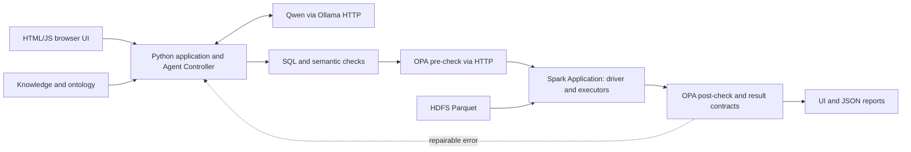

> Historical audit/source validation: for the integrated deployed system and current test results, see [CURRENT_STATE.md](CURRENT_STATE.md). Main web is now8090; preview8091 is stopped.

# Agentic AI Analyst — architecture audit and instructor Q&A

Audited 3 November 2026 at local HEAD `76629c472bdde02c8c4490bf95a5bece468c1ea2`.
Origin matches `NATTAPAT-LEUNGRUNGSAP/customer-intelligence-agent-spark-hdfs`.
Codex lists this checkout as `customer-intelligence-Spark-HDFS`; “Agentic ai analyst” is the requested project context, not a verified sidebar label.

VERIFIED IMPLEMENTED means source/configuration verified, not newly tested in a running deployment. GitHub freshness could not be checked because DNS resolution failed. Historical reports were not rerun. The referenced chat was read as context; its claims were checked against source. The slide image itself was not inspected; mapping follows the supplied box labels.

## Architecture map

| Instructor box | Component and responsibility | Status and source evidence |
|---|---|---|
| Host / Application | Browser UI, Python application, Agent Controller, Qwen via Ollama | VERIFIED IMPLEMENTED: `web/`, `jobs/web_app.py:Application.query`, `jobs/agent.py:answer` and `generate`. UI is HTML/JavaScript, not Streamlit. |
| MCP Client in Host | Protocol session and tool invocation | PROPOSED. No actual MCP client/session found. |
| MCP Server A | Analytics tool interface invoking Spark | PROPOSED as MCP. Existing backend calls a Python callback to `jobs/query_runtime.py:run_query` directly. |
| Processing application behind Server A | Spark Application / Spark SQL | VERIFIED IMPLEMENTED: SparkSession in `jobs/agent.py:main` and `jobs/web_app.py:main`. Driver coordinates distributed jobs; executors compute. Spark Application is not inherently an MCP Server. |
| Local data source A | HDFS Parquet | VERIFIED IMPLEMENTED: `jobs/build_tables.py`, `query_runtime.load_views`, Hadoop configuration. HDFS stores data; it does not reason or execute SQL. |
| MCP Server B | BM25 RAG, ontology, business metadata interface | PROPOSED as MCP. Existing in-process retrieval and ontology modules are VERIFIED IMPLEMENTED: `jobs/retrieval.py`, `jobs/ontology.py`. |
| Local data source B | Metadata, ontology and policy files | VERIFIED IMPLEMENTED: `knowledge/`, `ontology/`, `policies/`. SHACL validates the ontology graph. |
| MCP Server C | Governance tools, OPA and SQL guardrails interface | PROPOSED as MCP. Existing AST guard and OPA HTTP integration are VERIFIED IMPLEMENTED: `jobs/sql_guard.py`, `jobs/policy_engine.py`, `policies/analytics.rego`. |
| Remote service C | External business APIs if needed | PROPOSED / no business API integration established. Ollama and OPA HTTP endpoints are not evidence of MCP. |

Current implemented flow:

Target slide topology is PROPOSED: Host with MCP Client → Server A → Spark Application → HDFS; Host → Server B → metadata/ontology; Host → Server C → governance/OPA. These are conceptual boxes, not deployed MCP services. Mandatory enforcement must remain inside analytics/data/output boundaries even if Server C is never selected by the agent.

## Agentic behavior and protocol audit

`jobs/agent.py:answer` retrieves evidence, routes requests, generates SQL/citations, validates SQL and semantic contracts, asks the same model to review evidence consistency, authorizes execution, invokes Spark, checks results and returns observations/errors for repair through `context_engine.repair_messages`.

`for attempt in range(3)` confirms **three total attempts: initial generation plus at most two repairs**, not three additional repairs. Each attempt may call generation and review, so attempts are not model calls. Context-budget exhaustion or unavailable/malformed OPA decisions stops early. Formula, overview and clarification routes can finish without SQL execution.

Agentic AI resides in Controller + LLM and its bounded feedback/repair loop. The controller fixes much of the workflow; autonomous selection among MCP tools and open-ended planning are not verified. Same-model review is not an independent correctness oracle. Generated proposals/decisions do not prove internal reasoning quality.

MCP is a client/server protocol, not a synonym for Agentic AI, Spark, REST, JSON or function calling. Inspection of tracked runtime, dependencies, deployment configuration and tests found no MCP SDK/session/server, initialization, tool discovery or `tools/call` path. Positive execution evidence shows direct Python callbacks and Ollama/OPA HTTP calls. Therefore actual MCP protocol is **not verified implemented**; A/B/C adapters and client remain PROPOSED.

## Privacy and governance: verified controls and gaps

VERIFIED IMPLEMENTED: read-only SQL AST/table/function restrictions, row cap, bounded Spark action, OPA pre/post decisions, semantic/result contracts, RDF/OWL + SHACL, and separate sharing gateway. `policy_facts` passes stage, tables, read-only status, row cap, attempt and result violations. OPA outage/invalid decisions block the agent SQL path.

PROPOSED / missing: mandatory pseudonymization, identity/purpose authorization, PII classification/filtering, HMAC secrets lifecycle, and privacy-specific OPA facts/rules. Current policies do not inspect caller identity, selected sensitive columns or raw output content. Narrow result contracts are not a general PII scanner. `run_query` itself collects SQL results; callers outside `answer` do not automatically receive its OPA enforcement.

`sql/orders.sql` retains `customer_id`; `load_views` exposes full Parquet views; `run_query` returns collected values. `web_app.Application.query` writes questions, SQL, rows, errors and attempts into JSON reports and returns most of the trace to the browser. These are leakage surfaces. Integrity SHA-256 hashes do not pseudonymize customers. “Anonymous orders” means missing customer IDs, not proven anonymization.

Mandatory privacy design (PROPOSED):

1. Enforce privacy at trusted data-access and output boundaries, not through an optional LLM-selected tool. Expose sanitized views; deny the application identity direct raw-table/HDFS access. Keep trusted ETL/evaluator privileges separate.
2. Consider stable `HMAC-SHA-256(secret, domain || canonical_identifier)` tokens with unambiguous encoding, tenant/purpose separation and key versioning. Keep keys outside source/prompts/reports; restrict tokenization and any re-identification mapping. Define rotation and avoid a public arbitrary-ID tokenization oracle.
3. Apply compulsory filtering/redaction before model feedback, UI/API responses, exports, reports and logs. Cover raw values in questions, SQL literals, aliases, free text, exceptions and traces, not only fields named customer_id.
4. Extend OPA pre-checks with authenticated identity, purpose and resource/column classification. Post-check sanitized output classifications, forbidden identifiers and disclosure risks. Missing identity/classification, policy failure or redaction failure must deny. Enforce inside analytics/output services regardless of tool choice.
5. Assess quasi-identifiers (country, date, amounts), rare groups, linkage, repeated-query differencing and behavioral inference. Add access controls and suitable aggregation/small-group controls. Stable tokens alone do not eliminate leakage.

Pseudonymization preserves linkability or controlled re-identification; it does not establish anonymization. Stable HMAC tokens still reveal equality and behavior. Anonymization requires a separate realistic re-identification assessment. This audit establishes no anonymity guarantee.

## Instructor Q&A

**ถาม: Spark Application อยู่กล่องไหน?**
ตอบ: อยู่หลัง analytics tool interface ฝั่ง Server A ในภาพเป้าหมายครับ แต่โค้ดตอนนี้เรียก Spark โดยตรง ยังไม่ใช่ MCP Server ส่วน Driver ควบคุมงาน Executors ประมวลผล และ HDFS เก็บข้อมูล

**ถาม: Agentic AI อยู่ตรงไหน?**
ตอบ: อยู่ใน Agent Controller ร่วมกับ Qwen ฝั่ง Host สร้าง SQL ตรวจสอบ รันงาน รับข้อผิดพลาดและแก้ได้รวมสูงสุด 3 attempts ยังไม่ได้ยืนยันการเลือก MCP tools แบบอิสระ

**ถาม: ทำ MCP แล้วหรือยัง?**
ตอบ: จาก source ที่ตรวจ ยังไม่พบ MCP client/server protocol ตอนนี้เป็น Python modules และ HTTP ไป Ollama/OPA ส่วน A/B/C เป็นสถาปัตยกรรมที่เสนอ

**ถาม: RAG และ ontology อยู่ไหน?**
ตอบ: ตอนนี้อยู่ใน application และอ่าน knowledge/ontology files หากเพิ่ม MCP จะเปิดผ่าน Server B ได้ SHACL ตรวจกราฟนิยาม ไม่ได้พิสูจน์ SQL หรือ privacy ทุกกรณี

**ถาม: ให้ LLM เลือก pseudonymization tool ได้ไหม?**
ตอบ: ต้องบังคับที่ data access และ output boundaries ห้ามโมเดลข้าม ปัจจุบันยังไม่พบการบังคับนี้ และ OPA ที่มีอยู่ยังไม่ใช่ PII policy ครบวงจร

**ถาม: รู้ได้อย่างไรว่าคำตอบถูก?**
ตอบ: เทียบผล Spark กับ reference SQL ตรวจ decision/clarification และ repair แยกจาก SQL ที่แค่รันผ่าน เพิ่มการทดสอบ leakage, policy violations และ latency ชุดที่ใช้ปรับระบบแล้วต้องเรียก development/regression ไม่ใช่ fresh holdout

## Prioritized plan (no runtime changes in this audit)

| Priority | Work | Completion evidence |
|---|---|---|
| P0 | Agree privacy/identity design and sensitive-field inventory | Roles, purposes, token/key lifecycle, sanitized views/output contract; adversarial tests show no raw IDs across UI/logs/errors/direct calls; missing policy/identity denies. Review token type changes against current SQL contracts. |
| P1 | Freeze baseline and evaluation | Record code/data/model/policy hashes; separate exposed development from new holdout; preserve failures before changing behavior. |
| P1 | Shared mandatory execution/delivery boundary | Every production entry point enforces authorization, validation and privacy; direct-call bypass tests fail; valid analytics preserve expected results. |
| P2 | Small MCP analytics proof of concept, after owner approval | Real client initialization/capability negotiation, tool discovery/invocation, input/result schemas, cancellation/timeouts and protocol-error tests. Propagate authentication and enforce policies on direct MCP calls. Compare outputs/latency with existing path. |
| P3 | Add knowledge/governance adapters only if useful | Stable evidence IDs and access controls; governance explanations never replace mandatory enforcement. Justify deployment cost and latency before splitting services. |
| P3 | Extend adaptive agent choices | Define supported tools, arguments, clarification/stopping rubric and approved traces; evaluate decisions beyond SQL repair. |

Ask the owner before major architecture/service refactors. This documentation change does not authorize one, alter runtime behavior or require an MCP migration to preserve existing functionality.

## Evaluation requirements

Existing `jobs/evaluate*.py` and `evaluation/README.md` cover retrieval, analytic result comparisons, clarification and timing. They do not establish MCP interoperability or comprehensive privacy safety.

| Dimension | Measurement to retain/add |
|---|---|
| Agent/tool decision quality | Labeled route/tool/argument/clarification/stopping accuracy, unsafe and unnecessary calls; distinguish controller routing from future autonomous selection. |
| SQL correctness and analytic results | Execution success separately from reference-result accuracy, ordering, tolerances, grain, population and period; aggregation parity after tokenization. |
| Repair success | Recovered initially failed repair-eligible cases / all initially failed repair-eligible cases; first-pass vs final accuracy, exhaustion, error categories and model calls. |
| PII leakage | Synthetic identifiers/canaries and adversarial prompts; scan all model/data/output/log/error boundaries; report leaked cases/fields over tested cases/fields. Zero observed leaks applies only to the tested attacks. |
| Policy violations | Unauthorized operations allowed / attempted; false denials; bypass, missing identity, OPA outage and malformed-decision cases. |
| Latency | p50/p95 end-to-end and stage timings, cold/warm startup separately, tokens/calls/retries and future MCP overhead. |

Predeclare thresholds before new evaluation. Require zero observed leakage/unauthorized success in privacy attack cases; agree utility/latency gates from baseline. Protect raw evaluation artifacts and report failures/sample sizes. Historical 196/200 development performance is not evidence for new privacy controls or MCP. No live Spark, OPA, Ollama or benchmark run was performed for this documentation-only audit.
