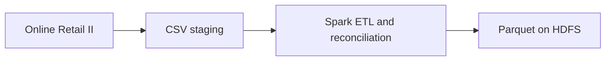
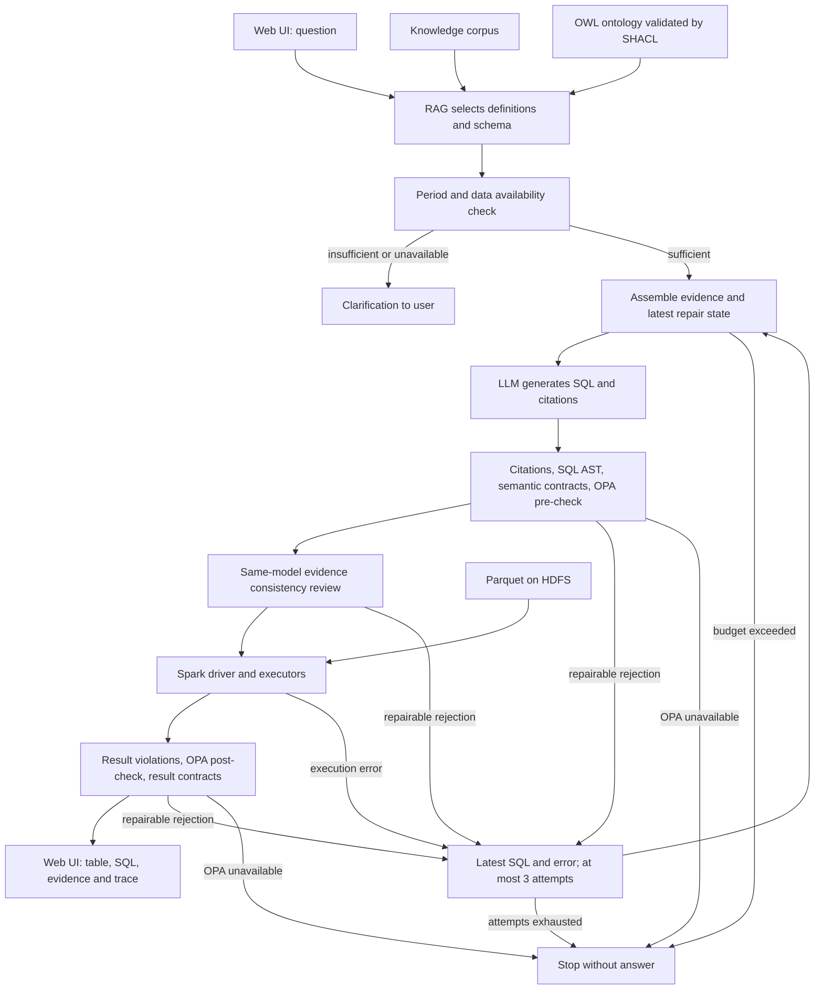

# Customer Intelligence

### เส้นทางเตรียมข้อมูล

### เส้นทางตอบคำถาม

RAG ค้นก่อนเริ่มวงรอบแก้ SQL ส่วนรอบแก้เก็บเอกสารเดิมและสถานะล่าสุด การเตรียมข้อมูลเป็นอีกงานหนึ่ง ไม่ได้ทำ ETL ใหม่ทุกคำถาม SHACL ตรวจกราฟนิยาม ส่วน SQL guards, OPA และ result checks ตรวจการเรียกเครื่องมือและผลลัพธ์คนละหน้าที่

HDFS has one NameNode and two DataNodes, replication 2. Spark has one master
and two workers. Everything runs on one physical Windows host under Docker
Desktop Linux, while Ollama runs on the Windows host GPU. This demonstrates
multiple processes/nodes, not resilience to loss of the physical machine.

SQL is generated dynamically. Gold SQL in evaluation is exclusively a test oracle,
not an agent query catalog. Model prose is not measured evidence; Spark rows,
build reconciliation and evaluation reports are the evidence. SQL guard reduces
the allowed query surface, but the unauthenticated local stack is not a production
security boundary. A local web application now calls the same guarded agent path.
Heuristic context budgeting rejects oversize prompts; repair history retains only
the latest rejected proposal/error. Exact token preflight is not implemented. Production deployment
is separate. See PRESENTATION_BRIEF.md for the revised delivery requirements.

Current source results: GOVERNANCE_REPORT.md. OPA decisions are required; unavailable or undefined decisions block execution/delivery. The ontology covers the project domain; it does not automatically map an unknown enterprise schema.
