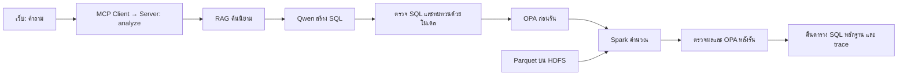

# สถาปัตยกรรม Customer Intelligence

Spark ETL อ่าน Online Retail II แล้วเขียนตาราง Parquet บน HDFS ไฟล์ manifest ระบุชุดข้อมูลที่ผ่านการเตรียม เว็บโหลดตารางจาก manifest ตอนเริ่มงาน

เมื่อข้อผิดพลาดแก้ได้ Agent ส่ง SQL กับเหตุผลล่าสุดกลับให้โมเดลภายในงบสามรอบ คำถามดู schema ใช้ข้อมูลที่โหลดไว้ ส่วน Dashboard ใช้ SQL ภาพรวมที่เตรียมไว้

ใน Docker เว็บส่งคำถามให้ Agent ผ่าน MCP แบบ Streamable HTTP ภายใน container ส่วน Spark ประมวล SQL ผ่าน PySpark, HDFS เก็บข้อมูล และ OPA ตัดสินนโยบาย Ollama รันโมเดลบนเครื่องหลัก แอปภายนอกสามารถเรียก Agent ผ่าน MCP แบบ stdio ได้

[อ่านโค้ดตามลำดับ](../docs/CODE_HANDOFF.md) · [จุดตรวจก่อนและหลัง Spark](../docs/TOOL_HOOKS.md)
